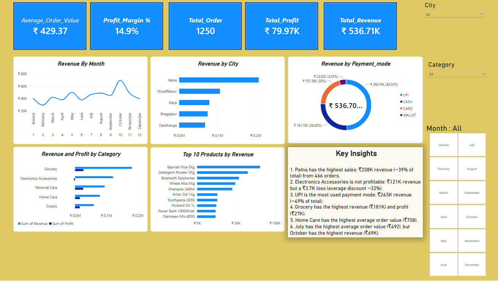

::: {align="center"}
# Power BI Sales Analysis Dashboard

``{=html}

**An interactive dashboard for exploring sales, revenue, profit, and
product performance.**
:::

------------------------------------------------------------------------

## Dashboard Preview

## Key Metrics

  Metric                    Result
  --------------------- ----------
  Total Revenue           ₹536.71K
  Total Profit             ₹79.97K
  Profit Margin              14.9%
  Total Orders               1,250
  Average Order Value      ₹429.37

## Analysis

-   Monthly revenue trends
-   Revenue by city
-   Revenue and profit by product category
-   Payment mode contribution
-   Top 10 products by revenue
-   Interactive filters for city, category, and month

## Tools Used

-   **Power BI** --- dashboard and visualisation
-   **Power Query** --- data cleaning and transformation
-   **DAX** --- measures and KPI calculations

## Repository Files

  File                              Description
  --------------------------------- -------------------
  `Shopeeasy Solved Project.pbix`   Power BI report
  `shopeasy_sales_2025.csv`         Source dataset
  `Dashboard.png`                   Dashboard preview

## Open the Report

1.  Download the `.pbix` file from this repository.
2.  Open it using **Microsoft Power BI Desktop**.
3.  If prompted, update the CSV source path to the location where you
    saved `shopeasy_sales_2025.csv`.
4.  Refresh the report.

------------------------------------------------------------------------

::: {align="center"}
**Created by [64yadav](https://github.com/64yadav)**

*Data Analytics • Business Intelligence • Data Visualisation*
:::
